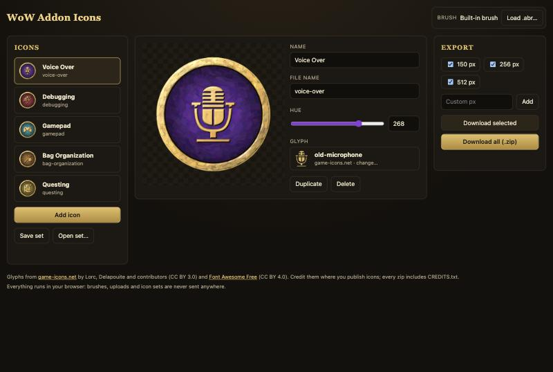

# WoW Addon Icons

Make medallion icons for World of Warcraft addons in your browser. Each icon has a hammered gold ring, a brush-painted panel tinted to the hue you pick, and a gold glyph traced along its own lines.

**[Open the app →](https://eiluviann.github.io/wow-addon-icons/)**



## Using the app

1. **Add an icon** for each addon group, then set its name, file name and hue.
2. **Pick a glyph.** You can search about 4,000 game-icons.net glyphs and about 2,000 Font Awesome Free glyphs, or upload your own SVG. An uploaded SVG needs a `viewBox` and at least one `<path>`.
3. **Choose a brush.** The built-in procedural brush is the default. Load a Photoshop `.abr` file to paint the panel with your own brush tips.
4. **Export.** Tick the sizes you want (150, 256 or 512 px, or any custom size of at least 150), then download the selected icon or the whole set as a zip. The zip has `<size>/<slug>.png`, `svg/<slug>.svg` and `CREDITS.txt`.

The app saves your icon set in the browser. **Save set** and **Open set…** move it between machines as JSON.

Everything runs on your own device. Brushes, uploaded SVGs and icon sets are never sent anywhere. That means you can load a brush you own but may not redistribute.

## Development

Requires Node 24+ and pnpm.

```sh
pnpm install
pnpm dev         # app at http://localhost:5173
pnpm build       # static site in web-dist/
pnpm preview     # serve the build
pnpm typecheck && pnpm lint && pnpm test
```

Pushing to `main` deploys to GitHub Pages through `.github/workflows/pages.yml`. To enable it, set **Settings → Pages → Source** to **GitHub Actions**.

### Command-line export

The same renderer runs as a [Bun](https://bun.sh) CLI for the groups listed in `src/icon-groups.ts`:

```sh
pnpm export                                # dist/{150,256,512}/<slug>.png, dist/svg, dist/preview.html
pnpm export --only gamepad,questing        # selected groups
pnpm export --sizes 150,400                # custom sizes (minimum 150)
pnpm export --brush brushes/my-brush.abr   # paint with .abr brush tips
```

### Layout

- `src/` holds the rendering core and the CLI. The core is pure: it takes an injected `SvgRasteriser`, which is resvg-js in Node and resvg-wasm in the browser.
- `web/` holds the Vite app. Rendering runs in a Web Worker so the UI stays responsive, and the glyph catalogue loads lazily in its own chunk.
- `brushes/` is gitignored. Keep any brushes you can't redistribute there.

## Credits and licences

The code is under the [MIT](LICENSE) licence. The glyphs are not, and must be credited wherever you publish icons that use them:

- [game-icons.net](https://game-icons.net) by Lorc, Delapouite and contributors, [CC BY 3.0](https://creativecommons.org/licenses/by/3.0/).
- [Font Awesome Free](https://fontawesome.com) icons, [CC BY 4.0](https://creativecommons.org/licenses/by/4.0/).

Each exported zip includes a `CREDITS.txt` with these lines.
